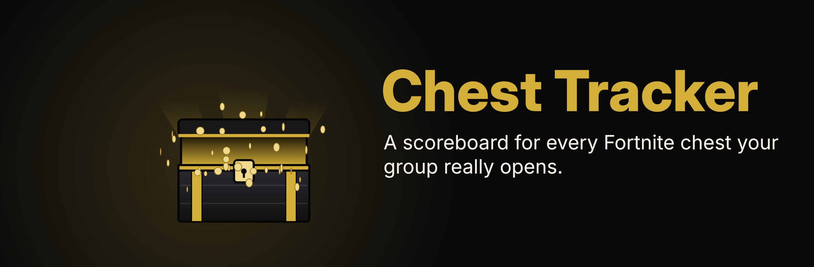
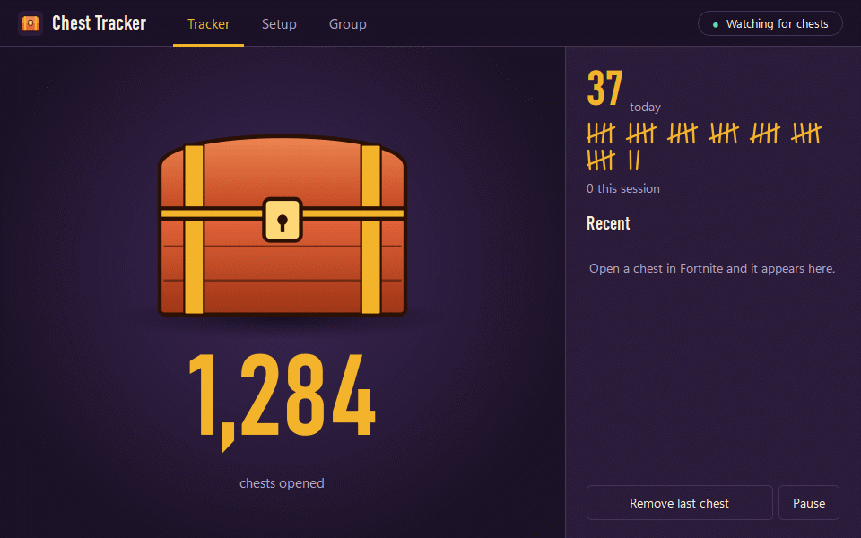
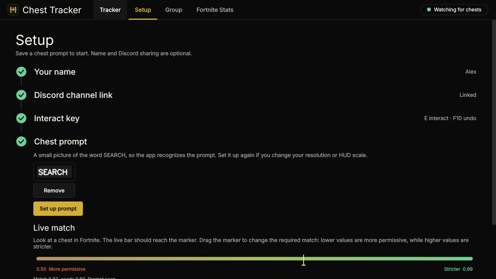
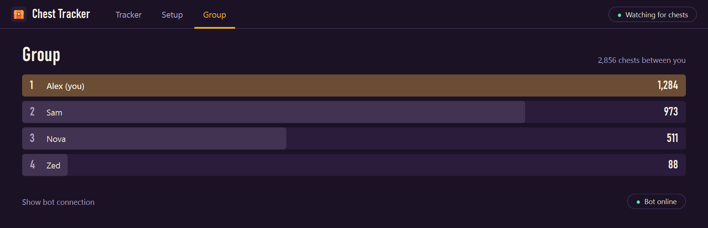

<p align="center">
  
</p>

<p align="center">
  <a href="../../releases/latest/download/Chest-Tracker.exe"><b>Download for Windows</b></a>
  &nbsp;&nbsp;|&nbsp;&nbsp;
  <a href="#how-a-chest-gets-counted">How counting works</a>
  &nbsp;&nbsp;|&nbsp;&nbsp;
  <a href="#set-up-the-discord-bot">Set up the Discord bot</a>
</p>

<p align="center">
  <a href="../../actions/workflows/tests.yml"></a>
  
  
  
</p>

Chest Tracker counts the Fortnite chests you open and can keep a shared leaderboard in Discord. It also works in local-only mode: counts stay on this PC and no Discord setup is needed.

This fork is based on [Xxoris190/chest-tracker](https://github.com/Xxoris190/chest-tracker). The original project and its contributors retain their copyright; this fork keeps the original MIT license and notices.

<p align="center">
  
</p>

<sub>Screenshots and this animation show sample data.</sub>

## What it does

- **Counts real searches.** Cancelled searches and chests you only walk past don't count.
- **Shows it live.** The chest on screen lifts its lid during a search, bursts open when a chest counts, and slams shut on a cancel.
- **Works without Discord.** Your local totals and activity history work without a webhook or bot.
- **Can keep a group leaderboard.** Optionally connect Discord to total everyone's chests and answer `/chests` and `/leaderboard`.
- **Can show Fortnite stats.** Look up public Battle Royale stats by player name with an optional Fortnite-API.com key.
- **Doesn't lose chests.** If Discord can't be reached, chests are saved and sent later, and the bot catches up after being offline.
- **Works with your binds.** Use any key, a mouse button, the scroll wheel, or an Xbox-style controller button to interact.
- **Finds your screen.** It follows Fortnite to whichever monitor it's on.
- **Pause key.** Press **F9** in Fortnite to stop counting (say, in a party lobby or when you are messing about) and press it again to resume. The overlay shows PAUSED.
- **Optional chime.** A short sound when a chest is counted, for when you miss the animation. Off by default, with its own volume.
- **Optional in-game overlay.** Show the chest count over Fortnite, drag it clear of your HUD in Setup, and mouse input passes through while playing. You can change its size and opacity in Setup. The overlay is excluded from the app's own screen capture, so it can't be mistaken for part of the game.

## Get started

1. Download [`Chest-Tracker.exe`](../../releases/latest/download/Chest-Tracker.exe) and double-click it. The app is Windows-only: Fortnite no longer runs natively on macOS, and the app relies on Windows screen and input features.
2. If Windows shows "Windows protected your PC", select **More info**, then **Run anyway**. It appears because the app isn't signed with a paid certificate.
3. Open **Setup** and set the **Interact key** and **Chest prompt**. To calibrate the prompt, set Fortnite to **Windowed Fullscreen**, select **Set up prompt**, look at a chest, and press **F8**. Drag a box around the prompt to zoom in, then drag a tight box around only the word **SEARCH**.
4. Play. The app starts watching whenever Fortnite is the active window, and saves counts on this PC.

To share counts with a group, add your player name and Discord webhook in **Setup**. In Discord, open the channel's **Edit Channel > Integrations > Webhooks**. The Discord bot and leaderboard are optional too.

Open **Fortnite Stats** to enter a Fortnite-API.com key, player name and account platform, then select **Refresh stats**. The page shows lifetime or current-season overall and Solo/Duo/Squad stats. Stats requests are manual; the app doesn't sign in to Epic. Fortnite-API.com is an independent, non-official service and requires its own API key for stats. You can create one at the [Fortnite-API dashboard](https://dash.fortnite-api.com/account).

To use the in-game overlay, open **Setup**, enable **Show the chest count over Fortnite**, select **Set overlay position**, and drag the badge where you want it. Select **Done positioning** before returning to Fortnite. The overlay is hidden when Fortnite isn't the active window. **Size** and **Opacity** change as you drag the sliders; the badge is only visible during **Set overlay position** or in the game. It needs Windows 10 version 2004 or newer to stay out of the app's screen reads; on older builds, keep it away from the middle of the screen.

Closing the window keeps it counting from the system tray. To exit, right-click the tray icon and select **Quit**.

<p align="center">
  
  
</p>

## How a chest gets counted

Fortnite has no official way to report chest opens, so the app works it out from the screen. A chest counts about 3 seconds after you search it, once all of these are true:

1. The SEARCH prompt was on screen and you used your interact key.
2. You kept aiming at the chest for the first second.
3. The prompt stayed gone for the full 3 seconds.

If the prompt comes back while you are still aiming at the same spot, or you look away during that first second, the search is cancelled. There is one exception, so a fast run of chests isn't missed: if the prompt comes back only after your view has turned somewhere new, and you had kept your aim for that first second, you finished and moved on, so that chest counts straight away.

Counted one by mistake? Press **F10** while Fortnite is focused, or select **Remove last chest**. You can choose a different keyboard key in **Setup**; the app asks first if you pick one you also type with, because chat in Fortnite would then remove chests. Removing a chest when your count is already 0 does nothing, and nothing is sent to Discord.

To pause, press **F9** while Fortnite is focused or use **Pause tracking** in the window or tray. Nothing is counted while paused, and a search under way when you pause is dropped. Pausing also forgets presses made while paused. Undo, pause and interact must be three different keys. To hear the chime, turn it on under **Chime** in Setup and use **Play sound** to check the volume. Players can't add chests by hand, but someone with Manage Server can use `/add` in Discord.

### Known limits

The app can't see inside the game, so these rules are strong evidence rather than proof.

- Holding your aim past the first second and then cancelling could still count.
- The "moved on" rule counts a chest when the prompt returns to a new view. If you finish a search and then turn back to the same chest within 3 seconds, it is treated as a cancel and that chest is missed.
- The prompt only says SEARCH, so anything else with the same prompt, possibly including ammo boxes, can count. See [Help tell chests from ammo boxes](#help-tell-chests-from-ammo-boxes).
- Anyone with the webhook URL could post to the channel directly, so only share it with people you trust.
- Controllers: only Xbox-style pads (or ones that present themselves as Xbox pads) work, and only for the interact button. The undo key is still a keyboard key. PlayStation pads need Steam Input or DS4Windows to look like an Xbox pad.

## Set up the Discord bot

Only one person in your group needs to do this. Everyone else only needs the shared webhook URL.

| Discord command | What it does |
| --- | --- |
| `/chests` | Everyone's total and today's count. Add a player name to see just theirs. |
| `/leaderboard` | Top 10 players |
| `/add` | Corrects a player's count (Manage Server only) |
| `/reset` | Sets a player's count to 0 (Manage Server only) |

1. Go to the [Discord Developer Portal](https://discord.com/developers/applications), select **New Application**, then open **Bot**.
2. Select **Reset Token** and copy the token. Keep it secret, because anyone who has it controls your bot.
3. On the same page, turn on **Message Content Intent**.
4. Under **OAuth2 > URL Generator**, tick the scopes `bot` and `applications.commands`, and the permissions **View Channels**, **Read Message History** and **Send Messages**. Open the generated link and add the bot to your server.
5. Create a channel just for this, such as `#chest-log`, and make sure the bot can see it.
6. In Discord, turn on **User Settings > Advanced > Developer Mode**, then right-click the channel and select **Copy Channel ID**.
7. In the app's **Group** page, select **Show bot connection**, paste the token and channel ID, and select **Start bot**.

## Privacy and anti-cheat

**What the app does:** it takes screenshots while Fortnite is the active window and reads which keys and scroll input you use. It doesn't touch Fortnite's memory or files, and it doesn't press anything for you.

**What it sends:** Discord is optional; if configured, the app sends your player name and chest count to your webhook. If you use Fortnite Stats, the app sends the player name and Fortnite-API key to Fortnite-API.com over HTTPS when you select **Refresh stats**. The key and most recent result are stored in the local settings file; the key is not sent to Discord. Screenshots stay in memory and are thrown away. The only image saved for detection is the small prompt picture you select, on your own PC.

**Where your data lives:** your settings, API key, webhook URL and bot token are in `%APPDATA%\ChestTracker`, not in the `.exe`.

> [!WARNING]
> This is much lower risk than anything that modifies the game, but nobody can promise it's allowed under Epic's rules. Use it at your own risk.

## Troubleshooting

**Chests aren't being counted.** Open **Setup > Chest prompt** and watch **Live match** while you look at a chest in Fortnite.

- **The bar stays below the marker:** set up the prompt again. You can save several, such as one in a dark area. Remove old ones after changing resolution or HUD scale.
- **The status says "Can't see the game":** use Windowed Fullscreen, and try turning HDR off.
- **The bar passes but nothing counts:** check that **Interact key** matches your Fortnite binding.
- **Controller button isn't picked up:** in **Setup**, select the interact key box and press the button on the controller. It should appear as, for example, "Controller A button". Use the button you have bound to interact in Fortnite. If nothing happens, check that Windows sees the controller (Settings, Bluetooth & devices).

**Real chests show "Search cancelled".** Keep aiming at the chest for a second after searching.

**It counts when no prompt is showing.** Drag the **Live match** marker up to about 0.85 or 0.9.

**The Discord post fails.** Discord refuses player names that contain "discord" or "clyde", so Setup won't save one. If the app says Discord rejected your name, pick another in **Setup > Your name**. Your chests stay saved and are sent once it's fixed.

**Something else is wrong.** Check the log at `%APPDATA%\ChestTracker\chest-tracker.log`. It's useful to include in a bug report, and it doesn't contain your token or webhook URL.

### Help tell chests from ammo boxes

Ammo boxes show the same SEARCH prompt, so the app can't tell them apart from chests yet. To gather evidence, the log records how each attempt went, for example:

```
Attempt opened: 3.05s after pressing, key used for 1.31s, prompt gone 3.02s, lowest aim match 0.93, final match 0.95
Undo pressed 4.2s after the last counted chest
```

If you press undo after a false count, the log shows it right after the attempt. Send a few of these lines from chests and from ammo boxes in a bug report. If chests and boxes differ in how long the key is used or how long the prompt stays gone, the app can use that to tell them apart.

## Build from source

You need Windows and Python 3.12.

```bash
python -m venv .venv-app
```

```bash
.venv-app\Scripts\python.exe -m pip install -r requirements-dev.txt
```

Run the app:

```bash
.venv-app\Scripts\python.exe app.py
```

Run the tests:

```bash
.venv-app\Scripts\python.exe -m pytest
```

Build `Chest-Tracker.exe`:

```bash
powershell -ExecutionPolicy Bypass -File build.ps1
```

| File | What it holds |
| --- | --- |
| `detection.py` | The rules that decide whether a search counts |
| `watcher.py` | Screen capture, input checks, and sending to Discord |
| `wheel.py` | Scroll wheel detection through Windows raw input |
| `gamepad.py` | Xbox-style controller buttons through XInput |
| `bot.py`, `store.py` | The Discord bot and its database |
| `ui.py`, `widgets.py`, `overlay.py` | The app window, animated chest and in-game count badge |
| `chime.py` | The optional counted-chest sound, generated in code |
| `settings.py`, `protocol.py` | Saved settings and counts, and the rules for names, webhook links and messages |
| `tests/` | The automated tests. They run on any OS, since the Windows calls are stubbed |

To publish a release, push a tag such as `v1.0.0`. The **Release** workflow builds `Chest-Tracker.exe` and attaches it to a GitHub release, which is what the download link serves.
| `fortnite_stats.py` | The optional Fortnite-API player-stats lookup |

## License

[MIT](LICENSE)

Chest Tracker is an unofficial fan project. It isn't affiliated with, endorsed by, or sponsored by Epic Games. Fortnite is a trademark of Epic Games, Inc.
